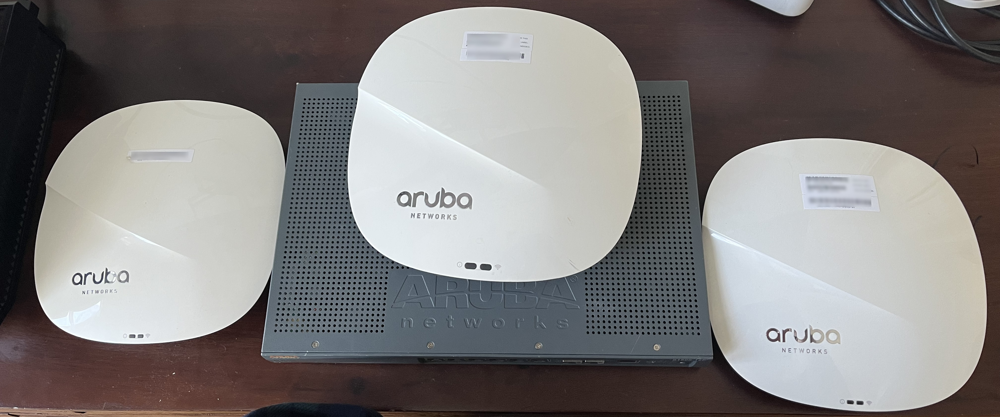
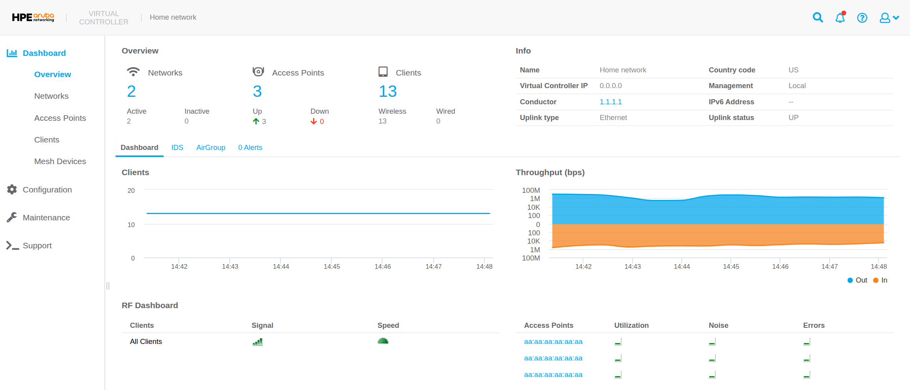
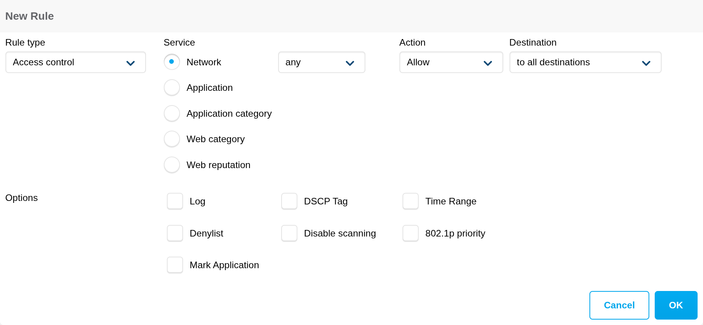

```{r setup, include=FALSE}
knitr::opts_chunk$set(echo = FALSE)
```

# Introduction
This is an exploration of Aruba WLAN management.
These are enterprise grade devices used in mass deployments like the Golden State Warriors stadium and San Francisco Airport.
Getting hands on with these devices provides a deeper understanding into the network requirements of businesses.

## Aruba devices inventory
- 1 Aruba IAP 335
- 2 Aruba AP 325
- S1500-12P



## Setup
All APs are connected via an ethernet connection to the switch.
The switch supports PoE (power over ethernet) so the APs receive power and data via the ethernet cables.
Other devices such as TVs or servers are also connected to the switch to take advantage of ethernet capabilities like full duplex.
This allows these devices to have a theoretical 1 GbE upload and download speed at the same time, for a total bidirectional speed of 2 GbE.

Currently, the Xfinity (XFI) XB7 provided from the ISP is the router in this network.
WiFi has been disabled in the XFI XB7 to mitigate radio frequency and confusion for client devices.
It handles the firewall configuration from the WAN which protects against unauthorized access to the internal LAN from malicious actors.
In addition, it handles DHCP which is the process of assigning IP addresses to client devices.

## Instant Web UI
Aruba's rise to fame began in the SD-WAN era.
One goal of SD-WAN is to simplify management of networks through software such as GUIs, REST APIs, CLIs, etc.
As such, the product comes with a very robust administration user interface.

One of the more pretty UI displays is the dashboard section.
This contains the `Overview`, `Networks`, `Access Points`, `Clients`, and `Mesh Devices` pages.
From these pages one can see all the clients that have utilized the APs in the last 15 minutes.
There is a RF (radio frequency) dashboard that shows if APs exceed utilization, noise, or error thresholds.
In addition, one can see clients with low speed or signal strength.



In the following sections, some of the more interesting features of the APs will be highlighted.
While the terminology may be specific to Aruba, many of the concepts will apply to other AP manufacturers.
Most of this knowledge can be accessed from clicking the profile icon in the upper right corner then navigating to online help in Aruba OS v8.
In addition, all of these features can be configured via the web UI.

## ARM (Adaptive Radio Management)
This is a feature that enables APs in the network to automatically adjust channel and power settings according to changes in the RF environment.
In an apartment building the RF environment is constantly changing due to neighboring WiFi networks.
APs will adapt to changes in the environment so optimal wireless signals are continuously accessible to client devices.
When using ARM, a channel change can result in dropped pockets, so a few factors must be considered to ensure a stable WLAN.

- **Client aware**: APs do not change channels with active clients unless for high priority events like radar or excessive noise.
- **Voice aware**: APs detect when a voice call is in progress and prevents the IAP from scanning other channels in the RF during this time. This significantly improves voice quality when a call is in progress as voice is particularly sensitive to dropped packets.
- **Load aware**: Scanning is disabled under high network traffic as this can consume precious resources.

It is actually a mandate that any radios operating in 5 GHz have the ability to detect and avoid interference with radar systems.
For example, if the APs were deployed at an airport, it would avoid channels or power settings that could interfere with mission critical systems used to communicate with airplanes.
This is why one of the first questions asked during set up is the country code, so APs can be compliant with local regulations.
If the APs detect radar it will immediately vacate the channel using the zero-wait DFS (Dynamic Frequency Selection) feature and seamlessly transition to a new one.

### Client match
Another ARM feature is client match which continuously monitors a clients RF neighborhood to provide on going band steering and load balancing.
Without this, clients may not automatically switch APs, a problem known as a sticky client.

By continuously polling the clients SNR (Signal to Noise Ratio) the APs can advise clients on the optimal connection.
If the device moves from one room to another that both have APs, client match helps the client seamlessly connect to the new AP.
However, if the new room does not have an AP, the band steering capability may be leveraged to negotiate the client down from 5 GHz to 2.4 GHz.
Ultimately, the client device makes the final decision and the APs can only nudge it in the right direction.

Client match also features dynamic load balancing so requests can be moved to another AP if the connection is sufficient and the current AP is almost at capacity.

## Radio
The AP 3xx series supports 2.4 GHz, 5 GHz, and 6 GHz radio bands which can be further tuned for network optimization.

Certain environments like an apartment building can subject the APs to radio interference which can negatively impact wireless connections.
There are 16 interference immunity levels to chose from which can improve performance in high interference environments.

The amount of RF interference is ever changing as people turn on microwaves or use cordless phones.
To accommodate for this, APs can use background spectrum monitoring to check for RF interference behind the scenes while continuing to provide normal service to clients.

As time progresses, APs can use the smart antenna feature to improve radio effectiveness.
This collect statistics about the RSSI (Received Signal Strength Indicator) from clients.
The data is then used as a positive feedback loop to adjust antenna polarization values.
Statistics are collected in the background to mitigate impact for the client.

## Access control rules
There are a variety of access control rules that can be configured in Aruba.
These settings can be applied to a wide variety of targets like individuals, groups, or a SSID like the guest WiFi.
Below is an explanation of some access control services.

- **Network**: Less secure networking protocols like FTP can be blocked to encourage use of SFTP.
- **Applications**: A very long list of common applications to block like Facebook, Instagram, or TikTok.
- **Web category**: An example would be social networking which would encapsulate a wide range of applications, as blocking every single social media application is labor intensive.
- **Web reputation**: A range from trustworthy to high risk to prevent access to suspect websites that could introduce malware to the network.

Note that blocking is not the only option for access control lists.
These events can simply be logged or the policy can be applied for a time range, such as late at night to prevent doom scrolling.



Applying access rules network wide is simple, but may be too strict.
Access rules can be applied precisely to a group of known child devices or an individual.
However, identifying which device in a network belongs to whom presents challenges due to MAC randomization or spoofing.
Authentication servers like RADIUS, LDAP, or TACACS can be integrated to address this.
In addition, Aruba profiles, users, or roles can be used in combination with a captive portal.

## IDS (Intrusion Detection System)
These are threats the AP will attempt to classify so there is better insight into security risks within the network.
An example of a potential threat would be `detect-adhoc-network` which is when clients communicate directly, bypassing any APs.
While all the pre defined threats can be detected, only some can be prevented by the APs.

IDS provides insights into foreign APs and classifies them in two ways.

- **Rogue AP**: These are unauthorized APs connected to the wired side of the network.
- **Interfering AP**: These are APs seen in the RF environment but not connected to the wired network. While it can cause RF interference, it is not considered a security threat as it is not connected to the wired network.

### OS fingerprinting
OS fingerprinting detects which OS the client is running.
This can help identify outdated, unexpected, or forbidden operating systems on a network.
As an OS may be outdated, fingerprinting can help locate a device so it can be updated to improve security.
Most major operating systems are detected, but a value of NOFP means the AP was unable to detect the OS.

### Tracking of randomized MAC address
This can help understand client behavior and network usage patterns.
For example, a mall may use this to measure foot traffic or identify overly congested areas.
However, there are probably better ways to detect visitor behavior like AI computer vision, LiDar, or thermal sensors.

## Future tasks
- RTLS (Real Time Location Services)
  - Allows one to track the location of objects or people within the premises.
- ALE (Analytics and Location Engine)
  - This provides visibility into everything the network knows, like destination IPs and applications used by clients.
- Syslog
  - Send syslog messages to an external server to store information such as when an invalid credential is given to the administration dashboard.

## Useful Linux commands for clients
```sh
# View the IP address for a device.
hostname -I

# View available networks, channels, rates, and signal strength.
nmcli dev wifi

# View information about the network interface or wireless hardware device. 
iw <dev/phy>

# Connecting to an AP via console port with a serial cable.
screen /dev/serial/by-id/<id>
enable
configure terminal
```

## Helpful links
- [Aruba OS 8.x Web Help](https://arubanetworking.hpe.com/techdocs/ArubaDocPortal/content/new-portal/instant.html?tab=4&topic=https%3A%2F%2Farubanetworking.hpe.com%2Ftechdocs%2FInstant_8.x_WebHelp%2FContent%2Fhomeinstant.htm)
- [Optimizing Aruba WLAN for Roaming Devices](https://higherlogicdownload.s3.amazonaws.com/HPE/MigratedAttachments/9B71B25A-80A1-4851-8B5F-21FDC9AB083F-2-VRD_Optimizing-WLAN-for-Roaming-Devices.pdf)